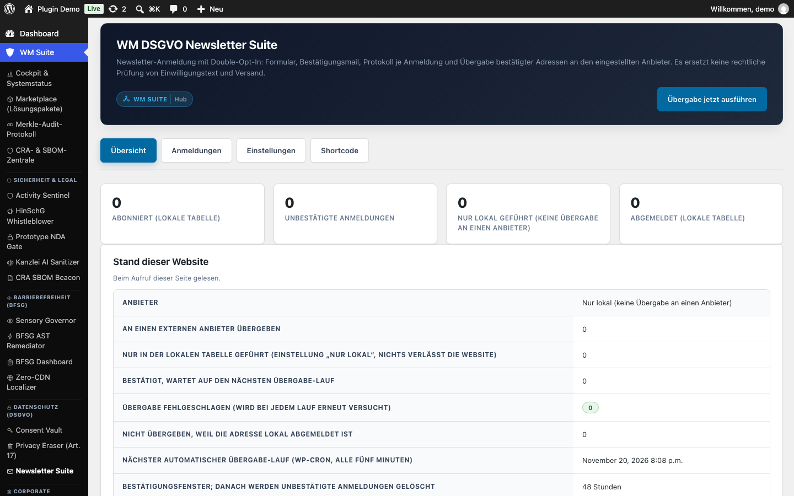
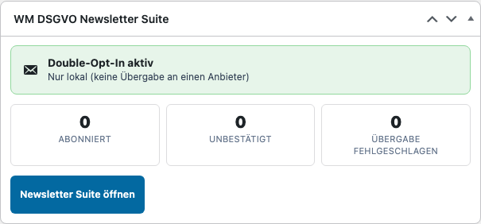

# WM DSGVO Newsletter Suite (Deutsche Dokumentation)

<p align="center">
  <a href="README.md"></a>
  <a href="README.de.md"></a>
  <a href="README.es.md"></a>
</p>

> **Ein Double-Opt-In-Anmeldeformular für WordPress: Einwilligungs-Checkbox und Proof-of-Work im Browser, eine Bestätigungsmail, ein Datensatz je Anmeldung mit Einwilligungstext, dessen Hash und einem geschlüsselten Hash der IP-Adresse, und die serverseitige Übergabe bestätigter Adressen an Brevo, Rapidmail, CleverReach, Kit oder Mailchimp — es versendet keine Newsletter, gibt Abmeldungen nicht an den Anbieter weiter und bewertet Einwilligungstext und Versand nicht rechtlich**  
> **Plugin-Seite:** [https://arnoldwender.com/wordpress-plugins/wm-dsgvo-newsletter-suite/](https://arnoldwender.com/wordpress-plugins/wm-dsgvo-newsletter-suite/)  
> **Mit einem agentischen Workflow entwickelt:** entstanden mit KI-Coding-Agenten. Prüfen und testen Sie es wie jeden fremden Code, bevor Sie es produktiv einsetzen.  
> **Support & Haftung:** Kein Support (Zero Support) — reproduzierbare Bugs ausschließlich über [GitHub Issues](https://github.com/arnoldwender/wm-wp-dsgvo-newsletter-suite/issues) · kein privater Support · OHNE GEWÄHR („AS IS“) / keine Haftung ([SUPPORT.md](SUPPORT.md))

> Jede Angabe in dieser Dokumentation ist gegen den Code in diesem Repository gemessen: Shortcode `[wm_dsgvo_newsletter]`, WP-CLI `wp wm-newsletter`, REST-Routen `/subscribe`, `/altcha-challenge`, `/unsubscribe` und `/webhook` unter `wm-newsletter/v1`, Tabellen `wp_wm_newsletter_doi_staging` und `wp_wm_newsletter_subscribers`, WordPress 6.5+ Block Bindings `wm-newsletter/stats`, GenerateBlocks 2.x Dynamic Tag `{{wm_newsletter_stat}}` sowie die Hooks `wm_newsletter_ready`, `wm_newsletter_confirmed`, `wm_newsletter_rest_rate_limit` und `wm_newsletter_subscriber_payload`. Die Änderungshistorie steht in [CHANGELOG.md](CHANGELOG.md).

---

## Live-Vorschau

!WM DSGVO Newsletter Suite Banner

| Übersicht | Double-Opt-In-Formular | Dashboard-Widget |
|---|---|---|
|  | ![Frontend-Anmeldeformular für Double-Opt-In über [wm_dsgvo_newsletter]](.wordpress-org/screenshot-2.png) |  |

---

## Was das Plugin leistet

1. **Formular:** `[wm_dsgvo_newsletter]` gibt einen Abschnitt mit Überschrift (`title`, Standard „Newsletter abonnieren“), optionaler Beschreibung (`description`), beschriftetem Adressfeld, Schaltfläche (`button_text`, Standard „Anmelden“), Einwilligungs-Checkbox mit Link zur Datenschutzerklärung aus den Einstellungen, zwei Honeypot-Feldern und einer Statuszeile aus. `list_id` (leer, solange nicht gesetzt; das steht für die Liste aus den Einstellungen) und `legal_basis` (`art_6_1_a` oder `art_6_1_b`) stehen in versteckten Feldern, zusammen mit einer HMAC-Signatur über beide. Stylesheet und Skript werden nur auf Seiten geladen, die das Formular ausgeben.
2. **Proof-of-Work & REST-Zugriffsschutz:** Vor dem Absenden holt das Skript `GET /wp-json/wm-newsletter/v1/altcha-challenge` und sucht die Zahl, deren SHA-256 zusammen mit dem Salt die Challenge ergibt (Web Crypto, bis zu 50.000 Versuche). Eine Challenge gilt 10 Minuten und wird genau einmal angenommen. Alle drei öffentlichen REST-Routen (`/subscribe`, `/altcha-challenge`, `/unsubscribe`) laufen über `check_public_subscription_access()` mit Transient-basiertem IP-HMAC-SHA256-Ratenlimit (`wm_nl_rl_rest_*`, Standard 60 Anfragen pro 60 Sekunden, filterbar über `wm_newsletter_rest_rate_limit`, Ausnahmeregelung für `manage_options`, ohne Speicherung roher IP-Adressen).
3. **Anmeldung:** `POST /wp-json/wm-newsletter/v1/subscribe` erlaubt zusätzlich 5 Anfragen je Client-IP in einem festen 60-Sekunden-Fenster, beantwortet ein ausgefülltes Honeypot-Feld mit der normalen Erfolgsmeldung, ohne etwas zu speichern, und verlangt einen gültigen Proof-of-Work (403), eine gültige Adresse (400) und die Einwilligung (400). Liste und Rechtsgrundlage werden nur mit der Signatur des Formulars übernommen. Eine Zeile in `wp_wm_newsletter_doi_staging` speichert Adresse, SHA-256 eines zufälligen Tokens, HMAC-SHA256 der IP (Schlüssel `AUTH_SALT`), Einwilligungstext und dessen SHA-256, Liste, Anbieter, Rechtsgrundlage, Formular-ID und Status `PENDING_CONFIRMATION`.
4. **Bestätigungsmail:** HTML-Mail vom eingestellten Absender mit dem Link `/?wm_action=confirm_newsletter&token=…`, dem Hinweis, dass eine unbestätigte Adresse nach dem eingestellten Zeitfenster gelöscht wird, und Links zu Impressum und Datenschutzerklärung. Ist die RFC-8058-Einstellung an (Standard), trägt sie die Header `List-Unsubscribe` und `List-Unsubscribe-Post` mit der Abmelde-Route, der URL-kodierten Adresse und ihrem Token.
5. **Bestätigung:** Innerhalb des Zeitfensters (`doi_ttl_hours`, 1–168, Standard 48, gemessen in der Zeitzone der Website) wird die Zeile `CONFIRMED`, die Adresse in `wp_wm_newsletter_subscribers` als `subscribed` eingetragen und `do_action( 'wm_newsletter_confirmed', $email, $row )` ausgelöst; ein zweiter Klick meldet „bereits bestätigt“; ein abgelaufener Link setzt die Zeile auf `EXPIRED` und antwortet mit 410, bis die stündliche Löschung die Zeile entfernt, danach mit 404.
6. **Übergabe an den Anbieter:** Ein WP-Cron-Ereignis `wm_newsletter_process_sync_queue` nimmt alle fünf Minuten bis zu 25 Zeilen in `CONFIRMED` oder `SYNC_FAILED`, deren Adresse lokal nicht abgemeldet ist, übergibt `attributes`, `tags` und `list_id` an `apply_filters( 'wm_newsletter_subscriber_payload', $payload, $email, $provider )` (ohne den gespeicherten Einwilligungsnachweis zu verändern) und sendet sie an den bei der Zeile gespeicherten Anbieter (`local`, Brevo, Rapidmail, CleverReach, Kit oder Mailchimp). Fehlgeschlagene Übergaben werden `SYNC_FAILED` und schreiben unter `WP_DEBUG` Zeilen-ID, Anbieter und Antwort ins Fehlerprotokoll.
7. **Löschung:** Ein stündliches Ereignis `wm_newsletter_hourly_cleanup` löscht Zeilen in `PENDING_CONFIRMATION` oder `EXPIRED`, die älter als das Zeitfenster sind.
8. **Abmeldung:** `GET|POST /wp-json/wm-newsletter/v1/unsubscribe?email=…&token=…` (10 Anfragen je IP pro 60-Sekunden-Fenster) verlangt den Token `HMAC-SHA256(Adresse in Kleinbuchstaben, wp_salt('auth'))` und setzt die lokale Abonnentenzeile auf `unsubscribed`.
9. **Webhook:** `GET|POST /wp-json/wm-newsletter/v1/webhook` authentifiziert mit dem gespeicherten Schlüssel als `?key=` oder `Authorization: Bearer` und verarbeitet `unsubscribe`, `spam`, `contact_deleted`, `unsub`, `complaint` und `deleted`.
10. **Anfrageprüfung:** Parameter von Anfragen an `wm-newsletter/v1` mit Stream-Wrappern (`php://`, `data://` …), NUL-Bytes oder `base64_decode(`, `eval(`, `passthru(` werden mit 400 abgelehnt. Andere Anfragen an die Website werden nicht geprüft.
11. **Backend:** Menü *DSGVO Newsletter* (Position 32), Seite `wm-newsletter-suite`, 25 übersetzte `.po`/`.mo`-Sprachkataloge: *Übersicht*, *Anmeldungen* (letzte 50 Zeilen, CSV-Export bis 5.000 Zeilen mit Formel-Schutz), *Einstellungen* (inklusive Opt-in-Option `wm_newsletter_delete_data_on_uninstall` für die Datenlöschung beim Deinstallieren) und *Shortcode*. Dashboard-Widget und WM-Suite-Familien-Stylesheets.
12. **WP-CLI:** `wp wm-newsletter sync [--batch-size=<n>]`, `wp wm-newsletter purge-expired` (Alias `purge`), `wp wm-newsletter stats`.
13. **WM Suite Hub Spoke & SBOM:** `includes/Adapters/Newsletter_Spoke_Adapter.php` meldet sich über `wm_register_suite_module` an; CycloneDX 1.6 `bom.json` liegt im Hauptverzeichnis.
14. **Erweiterbarkeit & Block-Integrationen:** Actions `wm_newsletter_ready` und `wm_newsletter_confirmed`, Filter `wm_newsletter_rest_rate_limit` und `wm_newsletter_subscriber_payload`, WordPress 6.5+ Block Bindings `wm-newsletter/stats` sowie GenerateBlocks 2.x Dynamic Tag `{{wm_newsletter_stat}}`.

### Nicht enthalten

Das Plugin versendet keine Newsletter und hat keine Vorlagen, Kampagnen oder Öffnungs-/Klickstatistiken; eine Abmeldung wird nicht an den Anbieter weitergegeben; es gibt keinen Import, keinen eigenständigen Gutenberg-Formularblock, keinen Versuchszähler für fehlgeschlagene Übergaben, keine Hashkette über die Datenbankzeilen, kein PDF und keine rechtliche Bewertung von Einwilligungstext, Bestätigungsmail, Rechtsgrundlage oder Anbieter. Außer Brevo implementieren die Anbieter-Adapter nur das Hinzufügen eines Kontakts.

---

## Schnellstart

1. Plugin installieren und aktivieren (WordPress 6.4+, PHP 8.2+). Die Tabellen entstehen bei der Aktivierung, das Übergabe-Ereignis wird beim nächsten Seitenaufruf eingeplant.
2. Unter **DSGVO Newsletter › Einstellungen** Absender, URLs von Datenschutzerklärung und Impressum, das Zeitfenster und den Anbieter mit Zugangsdaten eintragen; mit „Nur lokal“ bleiben die Adressen auf der Website.
3. `[wm_dsgvo_newsletter]` auf eine Seite setzen, die über HTTPS ausgeliefert wird (der Proof-of-Work braucht Web Crypto).
4. Mit einer eigenen Adresse anmelden, dem Link aus der Mail folgen und unter **Anmeldungen** und **Übersicht** nachsehen.
5. Die Webhook-URL aus den Einstellungen beim Anbieter eintragen, wenn er Abmeldungen zurückmelden soll.

Klassen, Routen, Hooks, Tabellen und Einstellungen: **[README.md](README.md)** (Referenz) und **[DEVELOPERS.md](DEVELOPERS.md)**.

```bash
php tests/test-suite.php         # Standalone-Suite inklusive Hooks, REST-Ratenlimit und Opt-in-Deinstallation
php tests/test-pot-freshness.php # Abgleich aller übersetzbaren Texte gegen das .pot
bash tests/run-mutations.sh      # macht jede Korrektur einmal rückgängig; die Suite muss jedes Mal scheitern
```

### Bekannte Einschränkungen

- Eine Abmeldung über das Plugin ändert nur die lokale Tabelle; der Anbieter behält den Kontakt, bis er dort entfernt wird oder der Webhook des Anbieters die Abmeldung zurückmeldet.
- Zeilen in `SYNC_FAILED` werden bei jedem Lauf erneut versucht; Zeilen lokal abgemeldeter Adressen werden nicht erneut versucht und zählen als zurückgehalten.
- Die Datensätze sind gewöhnliche Datenbankzeilen: Der Einwilligungs-Hash zeigt, welcher Text gespeichert wurde, nicht, dass die Zeile nie geändert wurde.
- Abmelde-Token und IP-Hashes hängen an den WordPress-Salts; ändern sich die Salts in `wp-config.php`, werden die Links in bereits versandten Mails ungültig.
- Mit eingeschaltetem Proof-of-Work können Besucher über reines HTTP (außer localhost) das Formular nicht absenden.
- Die Zugangsdaten der Anbieter liegen im Klartext in der Option `wm_newsletter_settings`.
- Standardmäßig bewahrt `uninstall.php` alle Einstellungen, Abonnenten und Einwilligungsprotokolle auf; das Löschen beim Deinstallieren erfolgt nur nach ausdrücklichem Opt-in über `wm_newsletter_delete_data_on_uninstall` in den Einstellungen.
- `languages/` enthält das aus dem Code extrahierte `.pot` sowie 25 vollständig übersetzte und kompilierte `.po`/`.mo`-Sprachkataloge.

---

## Konformität

- **Was das Plugin feststellt:** dass jemand mit Zugriff auf ein Postfach einem Link gefolgt ist, nachdem ein Formular mit Einwilligungs-Checkbox von einem Client abgeschickt wurde, dessen IP-Hash gespeichert ist, welcher Einwilligungstext zu dieser Anmeldung gespeichert wurde, und wann. Es entscheidet nicht, ob dieser Text, die Bestätigungsmail, die Rechtsgrundlage oder der gewählte Anbieter den Anforderungen des Wettbewerbs- oder Datenschutzrechts genügen.
- **Ausgehende Anfragen:** eine Bestätigungsmail je Anmeldung über `wp_mail()`; mit einem anderen Anbieter als `local` Adresse, Listen-ID und etwaige Attribute bestätigter Anmeldungen (bei CleverReach auch Anmelde- und Bestätigungszeitpunkt) an dessen API. Sonst verlässt nichts die Website; der Browser spricht nie mit dem Anbieter.
- **Personenbezogene Daten:** Adressen mit Einwilligungstext, geschlüsseltem IP-Hash und Zeitpunkten in beiden Tabellen; unbestätigte Zeilen werden nach dem Zeitfenster gelöscht, bestätigte und abgemeldete bleiben erhalten, bis sie manuell gelöscht werden oder das Plugin mit aktiviertem Datenlöschungs-Opt-in deinstalliert wird.

---

## Lizenz

Vertrieben unter der **GNU General Public License v2 oder neuer** (`GPL-2.0-or-later`).  
Copyright (C) 2026 Arnold Wender.  
