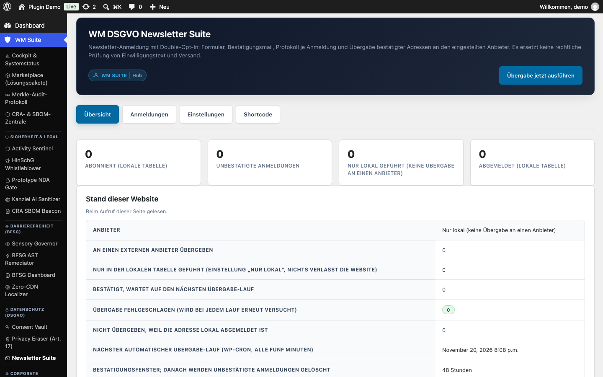
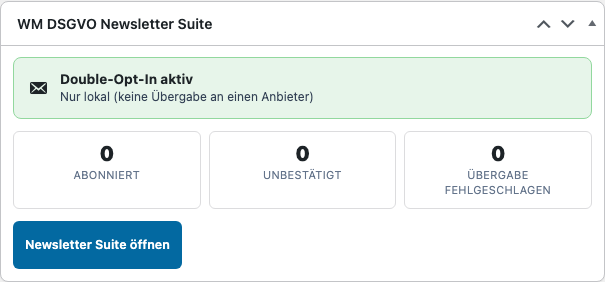

# WM DSGVO Newsletter Suite (Documentación en Español)

<p align="center">
  <a href="README.md"></a>
  <a href="README.de.md"></a>
  <a href="README.es.md"></a>
</p>

> **Un formulario de suscripción con doble opt-in para WordPress: casilla de consentimiento y prueba de trabajo en el navegador, correo de confirmación, un registro por suscripción con el texto de consentimiento, su hash y un hash con clave de la IP, y el envío desde el servidor de las direcciones confirmadas a Brevo, Rapidmail, CleverReach, Kit o Mailchimp — no envía boletines, no transmite las bajas al proveedor y no hace ninguna valoración jurídica del texto de consentimiento ni del envío**  
> **Página del plugin:** [https://arnoldwender.com/es/plugins-wordpress/wm-dsgvo-newsletter-suite/](https://arnoldwender.com/es/plugins-wordpress/wm-dsgvo-newsletter-suite/)  
> **Desarrollado con un agentic workflow:** creado con agentes de programación de IA. Revísalo y pruébalo como cualquier código de terceros antes de usarlo en producción.  
> **Soporte y responsabilidad:** Cero soporte (Zero Support) — errores reproducibles únicamente en [GitHub Issues](https://github.com/arnoldwender/wm-wp-dsgvo-newsletter-suite/issues) · sin soporte privado · TAL CUAL («AS IS») / sin responsabilidad ([SUPPORT.md](SUPPORT.md))

> Cada afirmación de esta documentación está medida frente al código de este repositorio: shortcode `[wm_dsgvo_newsletter]`, WP-CLI `wp wm-newsletter`, rutas REST `/subscribe`, `/altcha-challenge`, `/unsubscribe` y `/webhook` bajo `wm-newsletter/v1`, tablas `wp_wm_newsletter_doi_staging` y `wp_wm_newsletter_subscribers`, fuente de Block Bindings de WordPress 6.5+ `wm-newsletter/stats`, etiqueta dinámica de GenerateBlocks 2.x `{{wm_newsletter_stat}}`, y hooks `wm_newsletter_ready`, `wm_newsletter_confirmed`, `wm_newsletter_rest_rate_limit` y `wm_newsletter_subscriber_payload`. El historial completo está en [CHANGELOG.md](CHANGELOG.md).

---

## Capturas en vivo

!Banner de WM DSGVO Newsletter Suite

| Resumen del panel | Formulario doble opt-in | Widget del escritorio |
|---|---|---|
|  | ![Formulario público de suscripción con doble opt-in vía [wm_dsgvo_newsletter]](.wordpress-org/screenshot-2.png) |  |

---

## Qué hace el plugin

1. **Formulario:** `[wm_dsgvo_newsletter]` imprime una sección con un título (`title`, por defecto «Newsletter abonnieren»), una descripción opcional (`description`), un campo de dirección con etiqueta, un botón (`button_text`, por defecto «Anmelden»), una casilla de consentimiento con enlace a la política de privacidad de los ajustes, dos campos trampa (honeypot) y una línea de estado. `list_id` y `legal_basis` (`art_6_1_a` o `art_6_1_b`) viajan en campos ocultos junto con una firma HMAC de ambos. La hoja de estilos y el script solo se cargan en páginas que imprimen el formulario.
2. **Prueba de trabajo y límite REST:** Antes de enviar, el script pide `GET /wp-json/wm-newsletter/v1/altcha-challenge` y resuelve el desafío SHA-256 con Web Crypto (válido 10 minutos y de un solo uso). Las tres rutas REST públicas (`/subscribe`, `/altcha-challenge`, `/unsubscribe`) pasan por `check_public_subscription_access()` con límite de tasa basado en transients y HMAC-SHA256 de la IP (`wm_nl_rl_rest_*`, 60 peticiones por minuto por defecto, filtrable mediante `wm_newsletter_rest_rate_limit`, exento para `manage_options` y sin almacenar IPs en bruto).
3. **Suscripción:** `POST /wp-json/wm-newsletter/v1/subscribe` limita además a 5 peticiones por IP en una ventana fija de 60 segundos, responde 200 sin guardar nada ante un honeypot relleno y exige prueba de trabajo válida (403), dirección válida (400) y consentimiento (400). Una fila en `wp_wm_newsletter_doi_staging` guarda la dirección, el SHA-256 del token, el HMAC-SHA256 de la IP, el texto de consentimiento y su SHA-256, lista, proveedor, base jurídica, id del formulario y estado `PENDING_CONFIRMATION`.
4. **Correo de confirmación:** Correo HTML del remitente configurado con el enlace `/?wm_action=confirm_newsletter&token=…`, aviso del plazo de borrado de direcciones no confirmadas, enlaces legales y cabeceras `List-Unsubscribe` / `List-Unsubscribe-Post` (RFC 8058).
5. **Confirmación:** Dentro de la ventana (`doi_ttl_hours`, 1–168, por defecto 48, en la zona horaria del sitio) la fila pasa a `CONFIRMED`, la dirección se guarda en `wp_wm_newsletter_subscribers` como `subscribed` y se ejecuta `do_action( 'wm_newsletter_confirmed', $email, $row )`; un segundo clic responde «ya confirmada»; un enlace vencido marca `EXPIRED` y responde 410 hasta que el borrado horario la elimina (404 después).
6. **Envío al proveedor:** Un evento WP-Cron `wm_newsletter_process_sync_queue` toma cada cinco minutos hasta 25 filas en `CONFIRMED` o `SYNC_FAILED` cuya dirección no esté dada de baja localmente, filtra `attributes`, `tags` y `list_id` mediante `apply_filters( 'wm_newsletter_subscriber_payload', $payload, $email, $provider )` sin alterar el registro de consentimiento y las envía al proveedor (`local`, Brevo, Rapidmail, CleverReach, Kit o Mailchimp). Bajo `WP_DEBUG`, los fallos registran id de fila, proveedor y respuesta sin escribir la dirección de correo.
7. **Borrado:** Un evento cada hora `wm_newsletter_hourly_cleanup` borra las filas en `PENDING_CONFIRMATION` o `EXPIRED` más antiguas que la ventana.
8. **Baja:** `GET|POST /wp-json/wm-newsletter/v1/unsubscribe?email=…&token=…` (10 peticiones por IP cada 60 segundos) exige el token `HMAC-SHA256(dirección en minúsculas, wp_salt('auth'))` y pone la fila local en `unsubscribed`.
9. **Webhook:** `GET|POST /wp-json/wm-newsletter/v1/webhook` se autentica con la clave guardada (`?key=` o `Authorization: Bearer`) y procesa `unsubscribe`, `spam`, `contact_deleted`, `unsub`, `complaint` y `deleted`.
10. **Revisión de peticiones:** Los parámetros de peticiones a `wm-newsletter/v1` con envoltorios de flujo (`php://`, `data://` …), bytes NUL o llamadas `base64_decode(`, `eval(`, `passthru(` se rechazan con 400.
11. **Panel:** Menú *DSGVO Newsletter* (posición 32), página `wm-newsletter-suite`, 25 catálogos `.po`/`.mo` traducidos y compilados: *Übersicht*, *Anmeldungen* (últimas 50 filas y exportación CSV de hasta 5.000 filas protegida frente a fórmulas), *Einstellungen* (incluida la casilla opt-in `wm_newsletter_delete_data_on_uninstall` para el borrado de datos al desinstalar) y *Shortcode*.
12. **WP-CLI:** `wp wm-newsletter sync [--batch-size=<n>]`, `wp wm-newsletter purge-expired` (alias `purge`), `wp wm-newsletter stats`.
13. **Spoke de WM Suite Hub y SBOM:** `includes/Adapters/Newsletter_Spoke_Adapter.php` se registra mediante `wm_register_suite_module`; incluye `bom.json` CycloneDX 1.6 en la raíz.
14. **Extensibilidad e integraciones de bloques:** Acciones `wm_newsletter_ready` y `wm_newsletter_confirmed`, filtros `wm_newsletter_rest_rate_limit` y `wm_newsletter_subscriber_payload`, fuente de Block Bindings de WordPress 6.5+ `wm-newsletter/stats` y etiqueta dinámica de GenerateBlocks 2.x `{{wm_newsletter_stat}}`.

### No incluido

El plugin no envía boletines ni tiene plantillas, campañas o estadísticas de apertura; una baja no se transmite al proveedor; no hay importación, bloque de formulario independiente en Gutenberg, contador de intentos para envíos fallidos, cadena criptográfica sobre las filas, exportación PDF ni valoración jurídica de textos de consentimiento, correos o proveedores. Salvo Brevo, los adaptadores de proveedor solo implementan añadir un contacto.

---

## Inicio rápido

1. Instala y activa el plugin (WordPress 6.4+, PHP 8.2+). Las tablas se crean al activar; el evento de envío se programa en la siguiente carga.
2. En **DSGVO Newsletter › Einstellungen** configura el remitente, las URLs de política de privacidad y aviso legal, la ventana y el proveedor con sus credenciales; con «Nur lokal» las direcciones permanecen en el sitio.
3. Coloca `[wm_dsgvo_newsletter]` en una página servida por HTTPS (la prueba de trabajo necesita Web Crypto).
4. Suscríbete con una dirección tuya, sigue el enlace del correo y revisa **Anmeldungen** y **Übersicht**.
5. Registra la URL del webhook de los ajustes en el proveedor si debe reportar las bajas de vuelta.

Clases, rutas, hooks, tablas y ajustes: **[README.md](README.md)** (referencia) y **[DEVELOPERS.md](DEVELOPERS.md)**.

```bash
php tests/test-suite.php         # suite autónoma incluidos hooks, límite REST y desinstalación opt-in
php tests/test-pot-freshness.php # verifica que cada cadena traducible esté en el .pot
bash tests/run-mutations.sh     # deshace cada corrección una vez; la suite debe fallar todas las veces
```

### Problemas conocidos

- Una baja a través del plugin solo cambia la tabla local; el proveedor conserva el contacto hasta que se elimina allí o su propio webhook reporta la baja.
- Las filas en `SYNC_FAILED` se reintentan en cada ejecución; las direcciones dadas de baja localmente no se reintentan y cuentan como retenidas.
- Los registros son filas ordinarias de base de datos: el hash del consentimiento muestra qué texto se guardó, no que la fila nunca se editó.
- Los tokens de baja y los hashes de IP dependen de las sales de WordPress; si cambian en `wp-config.php`, los enlaces ya enviados dejan de valer.
- Con la prueba de trabajo activada, los visitantes por HTTP simple (salvo localhost) no pueden enviar el formulario.
- Las credenciales de los proveedores se guardan en texto plano en la opción `wm_newsletter_settings`.
- Por defecto, `uninstall.php` conserva todos los ajustes, suscriptores y registros de consentimiento; solo elimina las opciones y las tablas si el administrador activó explícitamente `wm_newsletter_delete_data_on_uninstall` en los ajustes.
- `languages/` incluye el `.pot` extraído del código y los 25 catálogos `.po`/`.mo` traducidos y compilados.

---

## Cumplimiento

- **Lo que el plugin acredita:** que alguien con acceso a un buzón siguió un enlace después de que un formulario con casilla de consentimiento se envió desde un cliente cuyo hash de IP se guarda, qué texto de consentimiento se guardó para esa suscripción, y cuándo. No decide si ese texto, el correo de confirmación, la base jurídica o el proveedor elegido cumplen los requisitos legales.
- **Peticiones salientes:** un correo de confirmación por suscripción mediante `wp_mail()`; con un proveedor distinto de `local`, la dirección, el id de lista y los atributos de las suscripciones confirmadas a la API de ese proveedor. Nada más sale del sitio; el navegador nunca habla con el proveedor.
- **Datos personales:** direcciones con texto de consentimiento, hash de IP con clave y fechas en ambas tablas; las filas no confirmadas se borran al terminar la ventana, las confirmadas y dadas de baja permanecen hasta que se borran manualmente o se desinstala el plugin con el borrado de datos activado.

---

## Licencia

Distribuido bajo licencia **GNU General Public License v2 o posterior** (`GPL-2.0-or-later`).  
Copyright (C) 2026 Arnold Wender.  
